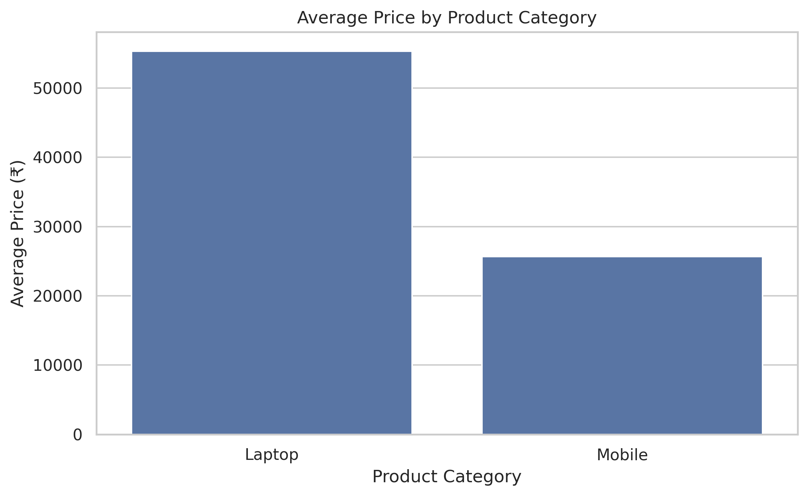

# 📱 Mobile and Laptop Price Comparison Analysis

## 📌 Project Overview

The Mobile and Laptop Price Comparison Analysis project uses Python to analyze product prices, brands, ratings, and specifications across Amazon and Flipkart. It applies data cleaning, exploratory data analysis, and data visualization to compare product listings and understand price differences.

**Note:** The initial dataset contains synthetic practice records. Actual marketplace conclusions require verified product listings.

## 🎯 Project Objectives

- Compare mobile and laptop prices across marketplaces.
- Analyze prices by brand and product category.
- Identify the lowest-priced product listings.
- Calculate price differences between matching products.
- Visualize price distributions and marketplace comparisons.
- Build an interactive dashboard for exploring the results.

## 🛠️ Technologies Used

- Python
- Pandas
- NumPy
- Matplotlib
- Seaborn
- Streamlit
- Google Colab

## 📂 Project Files

| File | Description |
|---|---|
| `Mobile_Laptop_Price_Analysis.ipynb` | Jupyter Notebook containing the analysis workflow |
| `app.py` | Streamlit dashboard application |
| `mobile_laptop_prices_cleaned.csv` | Cleaned product dataset |
| `marketplace_price_comparison.csv` | Marketplace price comparison results |
| `brand_price_analysis.csv` | Brand-wise price analysis |
| `average_price_by_category.png` | Average price visualization |

## 📊 Analysis Performed

- Data cleaning and preprocessing
- Average price calculation by category
- Brand-wise price analysis
- Amazon and Flipkart price comparison
- Identification of lowest-priced listings
- Data visualization using bar charts and box plots

## 📈 Visualization

The project includes a chart comparing average prices across product categories.



## 🚀 How to Run the Dashboard

### 1. Clone the repository

```bash
git clone https://github.com/Keerthika137/Mobile-Laptop-Price-Analysis.git
cd Mobile-Laptop-Price-Analysis
```

### 2. Install dependencies

```bash
pip install -r requirements.txt
```

### 3. Run the dashboard

```bash
streamlit run app.py
```

Open the local URL displayed in your terminal to explore the dashboard.

## 🔮 Future Improvements

- Expand the dataset with verified Amazon and Flipkart listings.
- Add interactive price-range and specification filters.
- Track product prices over time.
- Integrate a database using MySQL.
- Deploy the dashboard online.

## 👩‍💻 Author

**Keerthika G.**

- [GitHub](https://github.com/Keerthika137)
- [LinkedIn](https://www.linkedin.com/in/keerthika-g-22a333382)
